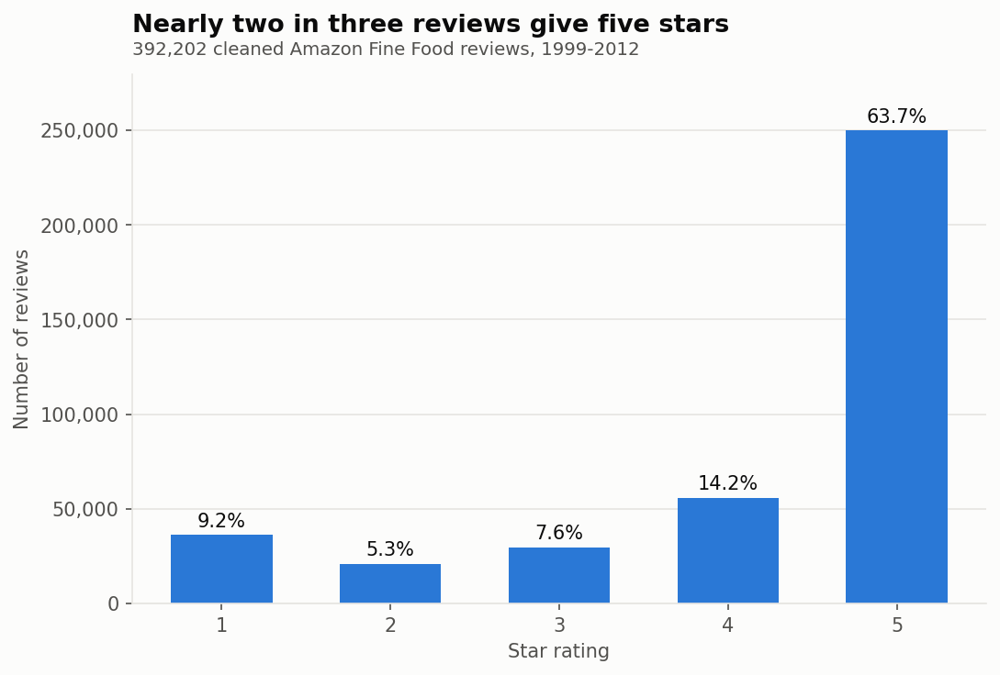
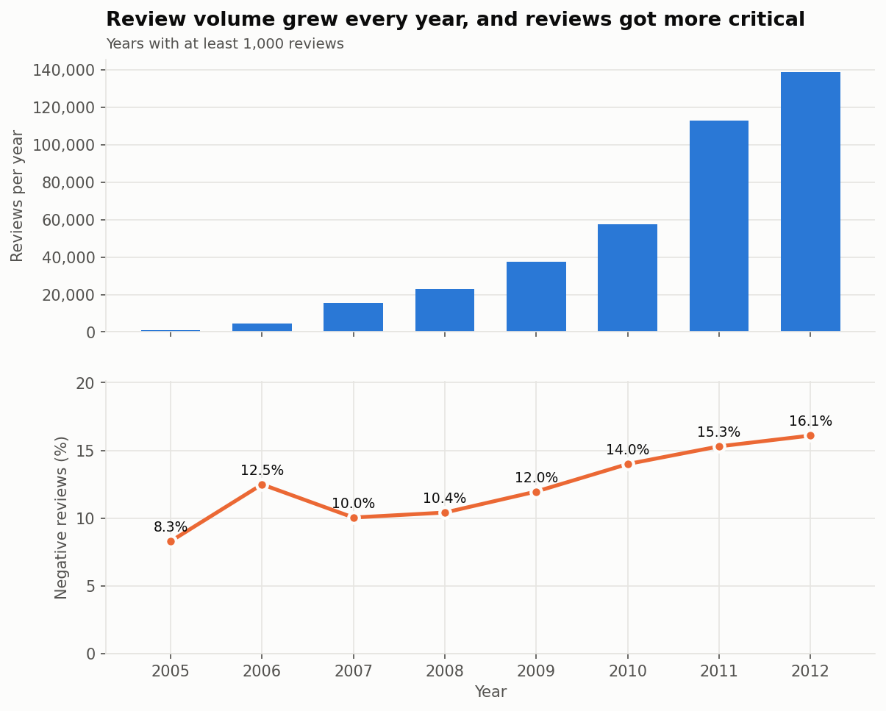
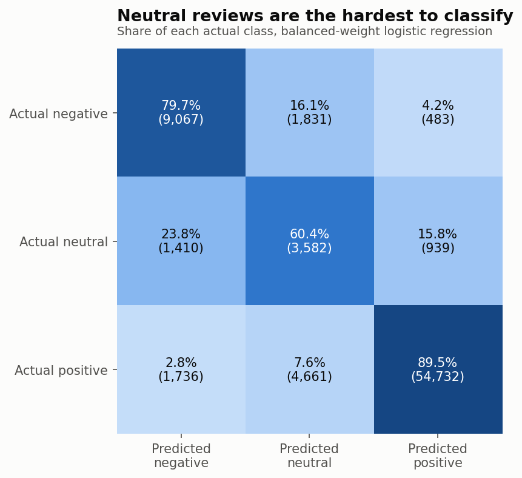
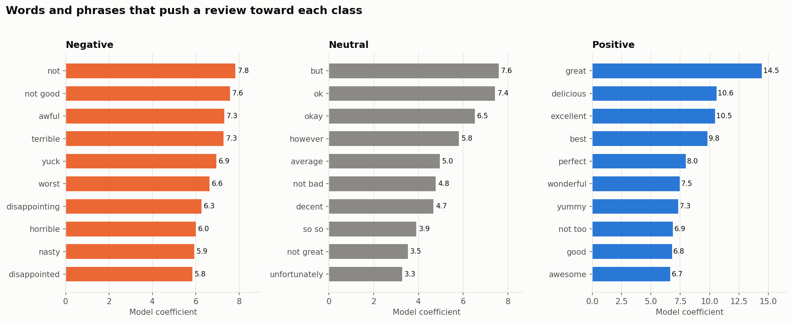
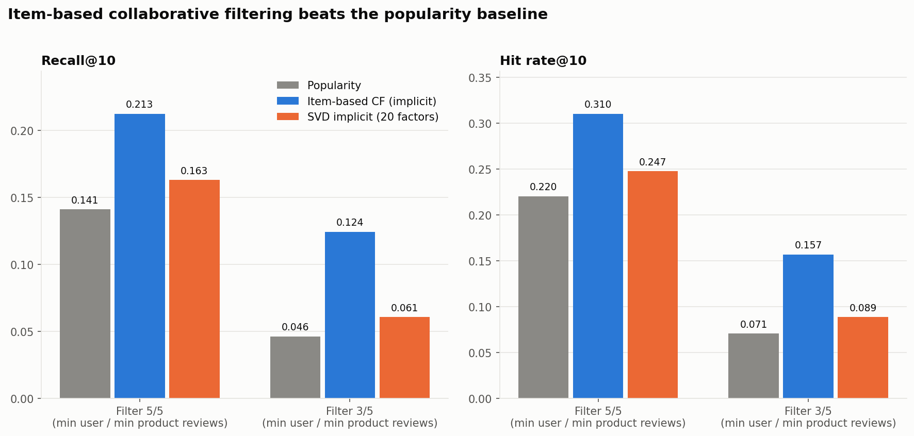

# 🛒 Amazon Fine Food Reviews: NLP, Sentiment Analysis and Recommender System

A full data analysis project on 392,202 Amazon Fine Food reviews (1999-2012).
It covers the complete data analysis life cycle: cleaning, exploratory analysis,
NLP sentiment classification, a recommendation system, and visualization.

---

## 📁 Project Structure

    amazon-reviews-nlp-recommender/
    ├── data/
    │   ├── raw/                      # Reviews.csv (not included, see Dataset)
    │   └── processed/                # Cleaned dataset (generated)
    ├── scripts/
    │   ├── 01_data_cleaning.py       # Cleaning, deduplication, feature engineering
    │   ├── 02_eda.py                 # Exploratory data analysis
    │   ├── 03_nlp_sentiment.py       # TF-IDF and sentiment classification
    │   ├── 04_recommendation.py      # Recommendation system
    │   └── 05_visualization.py       # Charts
    ├── outputs/
    │   ├── figures/                  # All saved charts (PNG)
    │   └── *.csv                     # Saved model metrics
    ├── README.md
    └── requirements.txt

---

## 📊 Dataset

- **Source:** [Kaggle - Amazon Fine Food Reviews](https://www.kaggle.com/datasets/snap/amazon-fine-food-reviews)
- **Size:** 568,454 raw reviews, 10 columns
- **Period:** October 1999 to October 2012
- **Contents:** user ID, product ID, star score (1-5), review summary, review text, helpfulness votes, timestamp

The raw file is about 300 MB, so it is not stored in this repository.
To reproduce the project, download `Reviews.csv` from Kaggle and place it in `data/raw/`.

---

## 🔧 Tools & Libraries

- Python 3
- pandas, numpy, scipy
- scikit-learn
- matplotlib

Install dependencies:

    pip install -r requirements.txt

---

## 🔄 How to Run

Run the scripts in order from the project root directory:

    py scripts/01_data_cleaning.py
    py scripts/02_eda.py
    py scripts/03_nlp_sentiment.py
    py scripts/04_recommendation.py
    py scripts/05_visualization.py

---

## 🔍 Key Findings

### Data Cleaning
- Reduced 568,454 raw reviews to **392,202** clean reviews with no missing values and no duplicates
- Removed 174,562 duplicate reviews (same user, time and text) and 1,408 repeat reviews of the same product by the same user
- Removed 2 rows with more helpful votes than total votes
- Decoded HTML entities and stripped HTML tags (102,595 reviews contained tags), then removed 280 further duplicates the cleaning created
- Converted the Unix timestamp to a date and engineered word count, sentiment label (1-2 stars negative, 3 neutral, 4-5 positive) and helpfulness ratio

### Exploratory Data Analysis
- **63.7%** of reviews are 5 stars and the average score is 4.18
- Sentiment classes are heavily imbalanced: **77.9% positive, 14.5% negative, 7.6% neutral**
- Review volume grew from 15,663 in 2007 to 138,821 in 2012, and the negative share rose from 10.0% to 16.1%
- Neutral reviews are the longest (mean 95 words) and 5-star reviews the shortest (mean 73)
- Negative reviews draw more helpfulness votes on average (5.9 vs 3.7 for positive) but a lower share of helpful votes (0.56 vs 0.86)
- **80.5%** of users wrote a single review and 42% of products have only one review, so the recommender needs an activity filter

### NLP and Sentiment Classification
- TF-IDF features (unigrams and bigrams, 100,000 features) with logistic regression, on a stratified 80/20 split (78,441 test reviews)
- Stopwords and negations were kept so phrases such as "not good" and "not bad" are features
- Explicit star mentions in the text (3.3% of reviews) were removed before training to avoid label leakage

| Model | Accuracy | Macro F1 | Neutral F1 | Neutral recall |
|-------|----------|----------|------------|----------------|
| Baseline (always positive) | 0.779 | 0.292 | 0.000 | 0.000 |
| Logistic regression | 0.897 | 0.711 | 0.390 | 0.295 |
| Logistic regression, balanced class weights | 0.859 | 0.717 | 0.448 | 0.604 |

- Both models clearly beat the baseline
- Class weights are a trade-off: neutral recall doubles, but accuracy falls by 3.8 points
- **Neutral (3-star) reviews are the hardest class**, since they mix praise and complaints
- Top words match intuition: "awful", "terrible" and "not good" for negative, "but", "okay" and "not bad" for neutral, "delicious", "excellent" and "perfect" for positive

### Recommendation System
- Main setup: users and products with at least 5 reviews each (2,477 users, 934 products, 25,654 ratings, 1.1% density), with a 3/5 filter as a comparison
- About 20% of each user's ratings were held out for testing
- **Ranking:** item-based collaborative filtering beats a popularity baseline

| Filter | Model | Recall@10 | Hit rate@10 |
|--------|-------|-----------|-------------|
| 5/5 | Popularity | 0.141 | 22.0% |
| 5/5 | Item-based CF | 0.213 | 31.0% |
| 5/5 | SVD | 0.163 | 24.8% |
| 3/5 | Popularity | 0.046 | 7.1% |
| 3/5 | Item-based CF | 0.125 | 15.7% |
| 3/5 | SVD | 0.061 | 8.9% |

- **Rating prediction:** no model beat the simple product average on RMSE (5/5 filter: product mean 1.066, SVD 1.082, item-based CF 1.145). Predicting exact star ratings is hard at this sparsity, while ranking is where collaborative filtering adds value

### Notes and Limitations
- The train/test split is random, not time-based
- The implicit-feedback models partly learn which products are reviewed together, so relevance is limited to held-out ratings of 4 or more
- Sentiment labels come from star scores, not manual annotation

---

## 📈 Visualizations

All charts are saved in `outputs/figures/`.

| # | Chart | Description |
|---|-------|-------------|
| 1 | Rating distribution | Share of reviews at each star score |
| 2 | Reviews per year | Volume and negative share over time |
| 3 | Review length | Words per review by sentiment |
| 4 | Reviews per user | Why the recommender needs a filter |
| 5 | Confusion matrix | Sentiment model results by class |
| 6 | Top words | Strongest words and phrases per class |
| 7 | Sentiment models | Baseline vs logistic regression |
| 8 | Recommenders | Popularity vs item-based CF vs SVD |

---

## 👤 Author

**Angela-99**

---

*This project is part of a data analytics portfolio demonstrating the full analysis life cycle.*